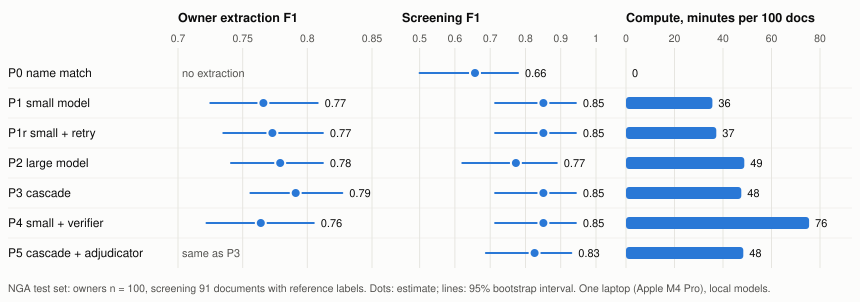

# Cheap first, escalate on failure: plan choice for provenance screening with local LLMs

Malek Khannoussi · work sample for the PhD position in the Mosaic project · October 2026. Independent work, not affiliated with HPI or MIT, not peer-reviewed; built with an AI coding assistant (section 7).

**Summary.** On 100 National Gallery of Art provenance texts, I compared seven ways of screening for transfers in 1933–1945 through persons on the 1946 ALIU Red Flag Names List, all with local models on one laptop, scored with 95% intervals. Reading the text with an LLM instead of matching names raised screening precision from 0.54 to 0.95. A larger model alone was not reliably better than a small one. A cascade that escalates only on a failed check beat the small model on owner extraction, but not the large model, and it is only cheaper than the large model when cost ratio plus escalation share is below 1, which barely held on the test set and failed on the dev split. A one-off reading by a stronger model (Claude) held the decisive step in every missed case: linking names to the list and dating holdings, not reading, limit screening. The museum's own structured owner list omits up to 148 owners that its texts name.

## 1. Question

Mosaic aims to turn research questions in the digital humanities into optimized queries over heterogeneous collections; provenance research on Nazi-era art is one of its target areas. ReCLAIM [1] already integrates archival sources for it, but no system yet chooses between ways of answering a question with known cost and measured correctness. This sample asks a small version of that question on public data: *which works in the National Gallery of Art (NGA) passed between 1933 and 1945 through a person or firm on the Red Flag list [7], and how should a system spend compute to answer it reliably?* Each object gets *flagged*, *not flagged* or *not decided*, with the quoted sentence behind every fact, for an expert to judge. "Flagged" means only that a listed name held the object in that period; the list names looters and agents, but also persecuted owners and mainstream firms.

## 2. Setup

**Data.** 100 distinct NGA texts [8] mentioning a year in 1933–1945, stratified for hard cases (footnote-only events, vague dates, name variants, cases name matching misses), and 20 texts from the Art Institute of Chicago (AIC) [9]. The test set and extraction prompt were fixed before any model ran; later experiments used a separate 30-document dev split.

**Reference data.** *Owners*: the NGA's structured list of previous owners (540). *Screening*: no domain expert was available. Two Claude agents, the second blind to the first, labelled the 54 cases where the name matcher found a listed name. They gave the same answer on 49 (91%, Cohen's κ = 0.84); the 5 disagreements (all about whether Knoedler New York is the listed Paris branch) and the 4 cases both marked unsure are left out. Role labels agree on 76%. Both labelers are instances of the same model, so agreement overstates independence. The other 46 objects were assumed not flagged. *AIC*: a blind Claude judge, unaware of which plan produced a name, rated each extracted owner.

**Plans** (local models via Ollama, Apple M4 Pro, 24 GB). Every event must quote the text exactly; unsupported quotes are counted and never used as evidence. A document is flagged when a listed owner's holding period, from their event to the next dated event, meets 1933–45.

| Plan | What it does |
|---|---|
| P0 | Red Flag full-name string match on the raw text |
| P1 / P2 | `qwen3:8b` / `qwen2.5:14b` extracts ownership events (owner, role, date, place, exact quote) |
| P1r | P1; on a parse error or truncation the same model retries with more output room |
| P3 | Cascade: P1, and P2 only when a free check fails (parse error, quote not in text, no dated 1933–45 event) |
| P4 | P1, then a second pass by the same model fixes, drops or adds events |
| P5 | P3, then an adjudicator reads each flagged match with the list entry's note |

## 3. Results

**Owner extraction (n = 100; 95% bootstrap intervals over documents).**

| Plan | Owners F1 | Unsupported | Errors | Compute (s) |
|---|---|---|---|---|
| P1 | 0.766 (0.725–0.808) | 1.0% | 2 | 2,137 |
| P1r | 0.773 (0.735–0.812) | 1.1% | 1 | 2,234 |
| P2 | 0.779 (0.741–0.812) | 2.6% | 3 | 2,928 |
| P3 | 0.791 (0.756–0.827) | 0.3% | 0 | 2,853 |
| P4 | 0.764 (0.722–0.805) | 0.8% | 2 | 4,531* |

\* later session. Paired differences: P3 − P1 +0.005 to +0.053; P3 − P1r +0.003 to +0.040; **P3 − P2 −0.012 to +0.041**; P2 − P1 −0.024 to +0.050.

**Screening (91 documents with a reference label).**

| Plan | Precision / recall | F1 (reference) | F1 (silver) |
|---|---|---|---|
| P0 | 0.54 / 0.85 | 0.66 (0.50–0.78) | 0.67 |
| P1, P1r, P3, P4 | 0.95 / 0.77 | 0.85 (0.71–0.94) | 0.76 |
| P2 | 0.94 / 0.65 | 0.77 (0.62–0.89) | 0.68 |
| P5 | 0.95 / 0.73 | 0.83 | |

P1 − P0 is +0.07 to +0.32 on reference labels but −0.04 to +0.23 on silver labels (derived with the same matcher as P0). 15 of P1's 22 flags involve one dealer, Contini Bonacossi, so the screening result rests on few distinct cases.

**Second institution (AIC, 20 texts, blind Claude judge).** Precision / recall: P1 0.99 / 0.90, P2 1.00 / 0.84, P3 0.99 / 0.91, the same order as at the NGA. The cascade escalated 10 of 20 AIC texts against 21 of 100 NGA texts. **Reproducibility:** ten test documents recomputed into an empty cache gave identical output (10/10).

## 4. What the numbers say

1. **No plan dominates on quality.** The cascade beats the small model (P1) and its retry (P1r) on owners, but not the large model; the large model beats neither. On screening P1, P1r, P3 and P4 tie at 0.85 and P2 reaches 0.77, all above name matching on the reference labels.
2. **Escalation recovers failures; it does not predict benefit.** Of the cascade's gain, 19 of 22 extra correct owners come from two documents where the small model's output broke. A same-model retry fixed the one that ran out of output room, at 4.5% extra compute, but not the malformed one, which the same model reproduced exactly at temperature 0. The date check never led to an improvement.
3. **The small model is not cheap here.** It wrote 32% more output (64,815 vs 49,208 tokens), so it cost 0.73 of the large model. A cascade is cheaper than the large model alone only when that ratio plus the escalated share of the large model's cost is below 1: 0.73 + 0.24 on the test set (P3 2,853 s vs P2 2,928 s), but 0.72 + 0.35 on the dev split, where a fresh wall-clock run gave P3 596 s against 531 s for P2 (model swaps added only 28 s).
4. **Extra passes and prompt tuning bought nothing.** A same-model verifier (P4) doubled compute with no gain on dev and test; a revised prompt gained +0.014 on dev, within noise. An adjudicator (P5) changed one verdict, wrongly.
5. **The museum's two descriptions disagree.** Up to 148 owners named in the NGA texts are absent from its structured owner list (61 of 100 objects), among them the Red Flag dealer Hans Wendland, and up to 38 acquisition dates differ by three years or more. These are upper bounds: approximate name matching links the Kress Foundation to Samuel H. Kress and some date pairs compare an end date with a start date. They are candidates for curators, and they make the structured list incomplete gold for every plan.
6. **Linking and dating, not reading, limit screening.** Claude read the texts once into a queryable graph (cf. Evaporate [10]) under explicit rules for repeat owners, joint buyers, agents and hedges. Its owner F1, 0.790 (0.757–0.823), does not differ from P3; a looser first reading scored 0.813, so conventions move this score as much as the model. Its screening has no false flag and 19 of 26 hits, and every miss holds the decisive step: a spelling ("K. Muhlmann", listed as "Muehlmann"), three firm entries, the Buchholz Gallery as Karl Buchholz's firm, two undated holders. The full-name rule links only 616 of the list's 1,019 surnames; repairing person names recovers the spelling case without new false flags (F1 0.844 → 0.870).

## 5. Related work and scale

P3 is a fixed-rule instance of the model cascades in LOTUS [4], which set routing thresholds on a sample with accuracy guarantees; finding 2 argues for routing on signals that predict benefit. P4 resembles DocETL's gleaning [5]; a same-size second pass did not help here. Palimpzest [2] chooses plans from prior estimates, which in a phase-0 spike were far from measured cost and quality on these texts; Abacus [3] replaces such priors with samples. Russo and Kraska [6] combine optimized operators with deep-research agents; `ask.py` is a minimal version of that loop: a local model reads the question, a plan is chosen from measured results and printed before it runs. At collection scale the first operator is a free year filter: 11,180 of the NGA's 81,540 provenance texts (4,324 distinct) mention 1933–1945, so P1 would need 15–26 hours on one laptop, depending on the session; decoding output dominates.

## 6. Limits

- Small and single-machine: 100 + 20 documents, one laptop, two open models; wide screening intervals and a screening result dominated by one dealer.
- No domain expert, and no human-checked labels: screening and AIC labels come from Claude agents of one model family, which also made the graph's reading; owner scores rest on the museum's incomplete data.
- The scorer matches owner names by token subsets and links foundations to their founders; its error is unmeasured and may be the size of the cascade's gain.
- P1's only screening false positive (NGA 52183) comes from the Red Flag matcher reading the list entry "Drouot, Hotel" as a person, compounded by the holding-period rule treating an auction as a holder. Not changed, to avoid tuning on the test set.
- Scoring changed after seeing results, for all plans alike: the verdict uses the holding period (the first rule gave P1 a screening recall of 0.16), the receiving museum is not a previous owner, quotes are compared with whitespace normalised; screening labels moved from silver to reference. Both are shown.
- Timing varies between sessions (the same answers took 648 s and 384 s), so plans are compared within one session.
- Partly met: one question type; flagged events rather than full timelines; no undecidable test cases. Output is evidence for experts, never a finding about a person or a restitution claim.

## 7. How this was made

I built the study with an AI coding assistant (Claude Code). I set the goals and constraints (public data, local models at zero cost, measured comparisons), made the decisions and reviewed the results; the assistant wrote most of the code, ran the experiments and drafted the analyses and this text. The plans ran on local models; Claude also made the reference labels, judged the Chicago answers and read the texts once for the graph. AI reviewer agents critiqued the drafts and the code; their corrections are reflected above. Every number can be recomputed from the repository.

## 8. Research question for three years

> How should an agentic data-processing system choose and adapt plans when its operators are LLMs, its data are historical records with incomplete and conflicting structure, and every answer must be traceable?

1. **Cost models that hold on the long tail.** Prior estimates were far off, and escalation rates changed between two museums. Can an optimizer learn per-collection estimates cheaply, with faithfulness as an objective next to quality, cost and latency?
2. **Routing on signals that predict benefit.** Free checks found failures, not where a larger model helps, and different failures needed different remedies. Which cheap signals predict the benefit of spending more, with guarantees?
3. **Data quality and entity resolution inside the loop.** The museum's structured data disagreed with its own texts, and both the scorer and the contradiction report were limited by name matching. Here linking and dating, not reading, limited screening (finding 6). An agentic system could resolve entities across sources and treat disagreements as signals of where to look, for the extraction and for curators.

## References

[1] Z. S. Janetzki, A. Krühler, et al., F. Naumann. ReCLAIM: An Integrated Platform for Data on Nazi-Looted Cultural Assets. BTW 2025, LNI.
[2] C. Liu, M. Russo, M. Cafarella, et al. Palimpzest: Optimizing AI-Powered Analytics with Declarative Query Processing. CIDR 2025.
[3] M. Russo, S. Sudhir, G. Vitagliano, et al. Abacus: A Cost-Based Optimizer for Semantic Operator Systems. arXiv:2505.14661, 2025.
[4] L. Patel, S. Jha, M. Pan, et al. Semantic Operators: A Declarative Model for Rich, AI-based Data Processing. arXiv:2407.11418, 2025.
[5] S. Shankar, T. Chambers, T. Shah, et al. DocETL: Agentic Query Rewriting and Evaluation for Complex Document Processing. arXiv:2410.12189, 2024.
[6] M. Russo, T. Kraska. Deep Research is the New Analytics System: Towards Building the Runtime for AI-Driven Analytics. CIDR 2026.
[7] OSS Art Looting Investigation Unit. Red Flag Names List and Index, 1946 (NARA); transcription by the Commission for Looted Art in Europe, lootedart.com.
[8] National Gallery of Art. Open Data Program, CC0. github.com/NationalGalleryOfArt/opendata.
[9] Art Institute of Chicago. Public API, CC0. api.artic.edu.
[10] S. Arora, B. Yang, S. Eyuboglu, et al. Language Models Enable Simple Systems for Generating Structured Views of Heterogeneous Data Lakes. PVLDB 17(2), 2023.
